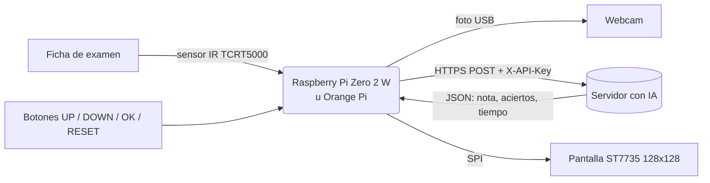
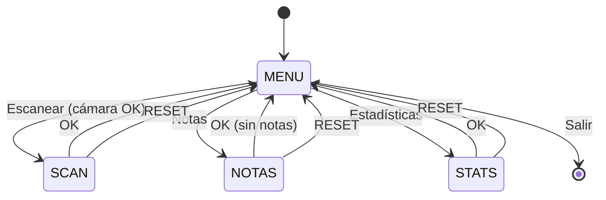

# Lector OMR autónomo con calificación por IA

Lector de fichas ópticas (OMR, *Optical Mark Recognition*) de bajo costo. Detecta por sí solo cuando se coloca una ficha de examen, la fotografía, la envía por API a un servidor donde una IA la corrige, y muestra la nota en una pequeña pantalla TFT. Toda la interfaz se maneja con 4 botones y está organizada como una **máquina de estados**.

Proyecto del curso **BMA20**.



## Características

- **Detección automática de la hoja.** Un sensor infrarrojo TCRT5000 detecta el papel. La hoja tiene que quedarse quieta 0,6 s antes de la captura, lo que evita fotos movidas.
- **Captura optimizada para OMR.** Imagen Full HD vía V4L2/MJPEG, se descartan los frames viejos del búfer, se convierte a escala de grises, se recortan los bordes y se mejora el contraste con CLAHE.
- **Envío asíncrono.** Un hilo en segundo plano (`APIManager`) sube las imágenes desde una cola, así puedes seguir escaneando mientras el servidor corrige.
- **Interfaz en pantalla TFT.** Tiene menú, pantalla de escaneo con iconos y barra de progreso, historial de notas con detalle por examen y estadísticas (fichas guardadas y temperatura del CPU).
- **Robustez.** La cámara se reconecta sola, se comprueba la escritura en disco al iniciar, hay un botón RESET global, el log es rotativo y se libera memoria explícitamente (pensado para los 512 MB de la Pi Zero 2 W).

## Estructura del repositorio

```
.
├── firmware/
│   └── rpi-zero2w/          ← VERSIÓN FINAL (Raspberry Pi Zero 2 W + API de IA)
│       ├── launcher.py         espera el botón OK y lanza main.py
│       ├── main.py             OMRSystem: máquina de estados principal
│       ├── api_manager.py      cola + hilo que envía las fotos al servidor
│       ├── camera_manager.py   detección/conexión de webcam USB y captura
│       ├── display_manager.py  dibujo de pantallas en la TFT ST7735
│       ├── input_manager.py    lectura de botones con debounce
│       ├── config.py           pines, resolución, API y logging
│       ├── requirements.txt
│       └── .env.example        plantilla para URL/API key del servidor
├── legacy/                  ← versiones anteriores (con motor de expulsión, sin IA)
│   ├── orange-pi-win-plus/
│   ├── rpi-zero2w-motor/
│   └── rpi-zero2w-v0/
├── deploy/
│   └── omr-launcher.service   servicio systemd para arranque automático
└── docs/
    ├── ARQUITECTURA.md         máquina de estados, clases y contrato de la API
    ├── HARDWARE.md             materiales y tablas de conexionado
    ├── presentacion-bma20.pptx
    └── img/                    diagramas y esquemas de conexión
```

## Hardware (versión final)

| Componente | Modelo |
|---|---|
| SBC | Raspberry Pi Zero 2 W (Raspberry Pi OS) |
| Cámara | Webcam USB Full HD (a través de un adaptador micro-USB OTG) |
| Pantalla | TFT 1.44" ST7735 de 128×128 px por SPI |
| Sensor de presencia | Módulo IR TCRT5000 (salida digital D0) |
| Entradas | 4 pulsadores a GND (UP, DOWN, OK, RESET) |

Las tablas de pines completas para Raspberry Pi y Orange Pi están en [docs/HARDWARE.md](docs/HARDWARE.md).

## Instalación (Raspberry Pi Zero 2 W)

1. **Habilitar SPI**: `sudo raspi-config` → *Interface Options* → *SPI* → *Enable*.
2. **Clonar e instalar dependencias:**

   ```bash
   git clone https://github.com/<tu-usuario>/<tu-repo>.git ~/omr
   cd ~/omr/firmware/rpi-zero2w
   sudo apt install python3-opencv python3-pil python3-pip fonts-dejavu
   pip install -r requirements.txt   # en Bookworm: agrega --break-system-packages o usa un venv
   ```

3. **Configurar el servidor de IA:**

   ```bash
   cp .env.example .env
   nano .env        # coloca OMR_API_URL y OMR_API_KEY
   ```

4. **Probar manualmente:**

   ```bash
   set -a; source .env; set +a
   python3 main.py
   ```

5. **Arranque automático** (opcional):

   ```bash
   sudo cp ~/omr/deploy/omr-launcher.service /etc/systemd/system/
   sudo systemctl daemon-reload
   sudo systemctl enable --now omr-launcher
   ```

   Al encender la placa, el lanzador espera a que presiones **OK** para iniciar el sistema. Las fotos se guardan en `firmware/rpi-zero2w/scans/` y el log en `system.log`.

## Uso

| Botón | Acción |
|---|---|
| **UP / DOWN** | Moverse por el menú o el historial |
| **OK** | Seleccionar, ver el detalle o volver |
| **RESET** | Desde cualquier pantalla: apaga la cámara y vuelve al menú (así también se sale de **Notas**) |

1. En el menú, elige **Escanear**.
2. Coloca la ficha. La pantalla pasa por *LISTO* → *Analizando…* (barra de progreso) → captura → *GUARDADO* → *Retire hoja*.
3. Retira la ficha y coloca la siguiente.
4. En **Notas** aparecen las calificaciones que devolvió la IA. Con **OK** ves el detalle: la nota (verde si es ≥ 10.5 sobre 20), las respuestas correctas sobre el total y el tiempo de proceso.

## Cómo funciona

El programa principal es una máquina de estados (`MENU`, `SCAN`, `NOTAS`, `STATS`) con una sub-máquina de escaneo. La IA corre en un servidor aparte: este repositorio solo contiene el **cliente embebido**, que habla con ella por HTTP.



Los diagramas detallados (sub-estados del escaneo, clases, hilo de la API y formato JSON) están en [docs/ARQUITECTURA.md](docs/ARQUITECTURA.md).

## Historia del proyecto

El prototipo empezó en una **Orange Pi Win Plus**, alimentada por una fuente ATX, con un **motor DC y un driver L298N** que expulsaban la hoja después de fotografiarla. La versión final pasó a una **Raspberry Pi Zero 2 W**, dejó de lado el motor y agregó la corrección por IA en un servidor. Las versiones anteriores están en [`legacy/`](legacy/README.md).

## Seguridad

La API key **no** va en el código: se lee de la variable de entorno `OMR_API_KEY` (archivo `.env`, que está en `.gitignore`).
