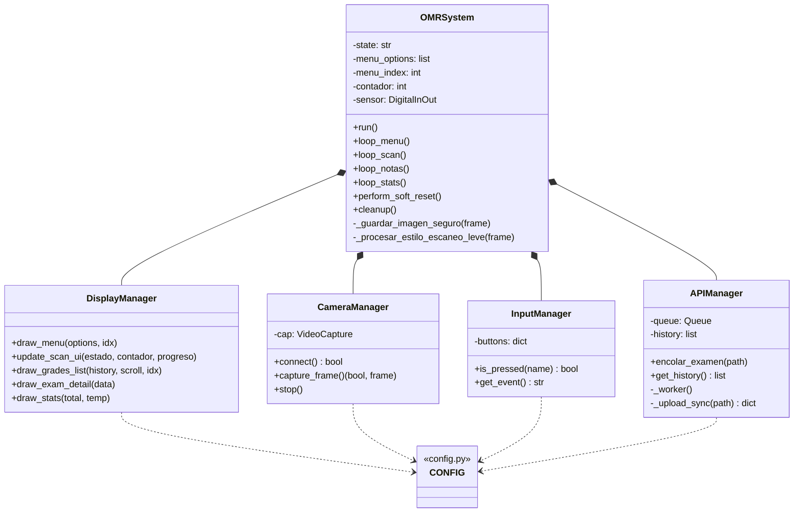
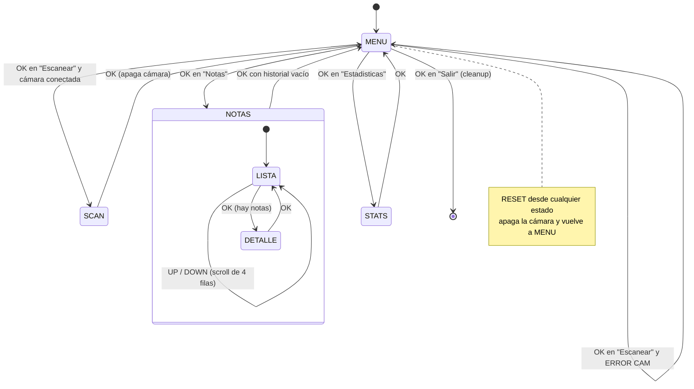
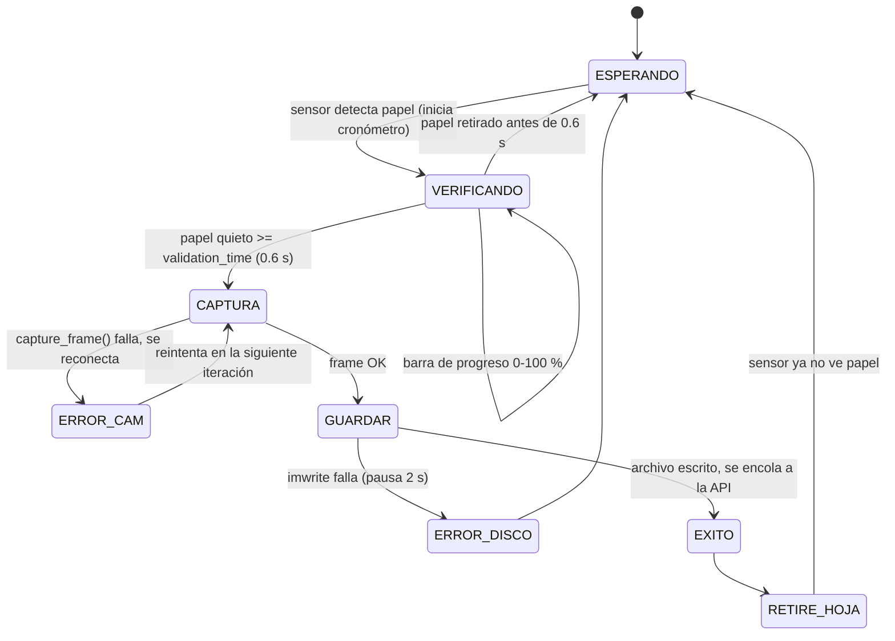
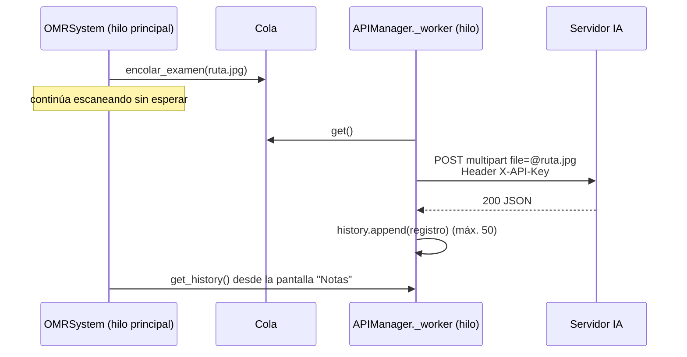
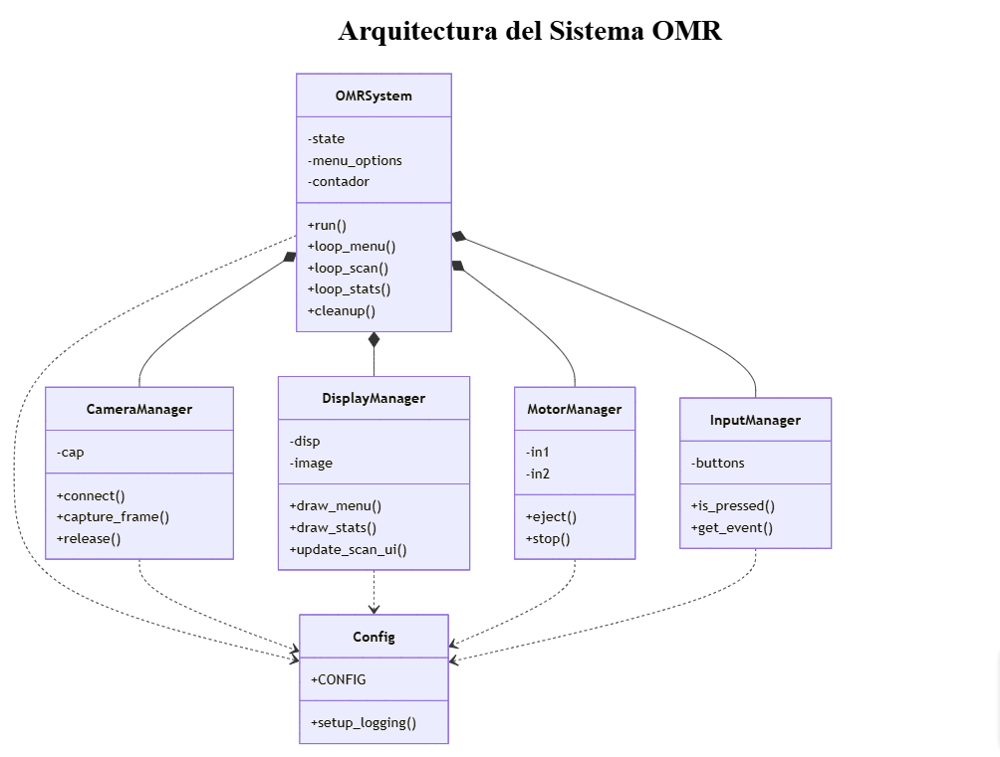
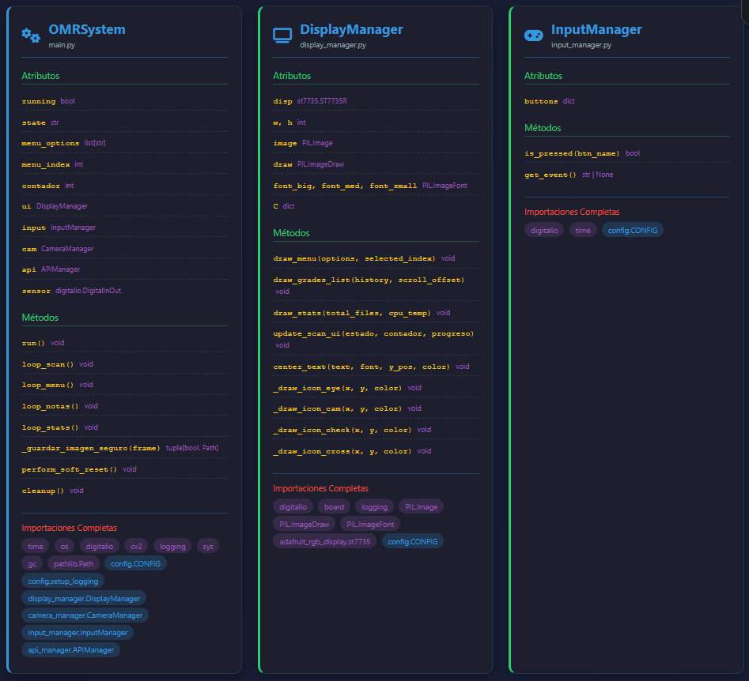
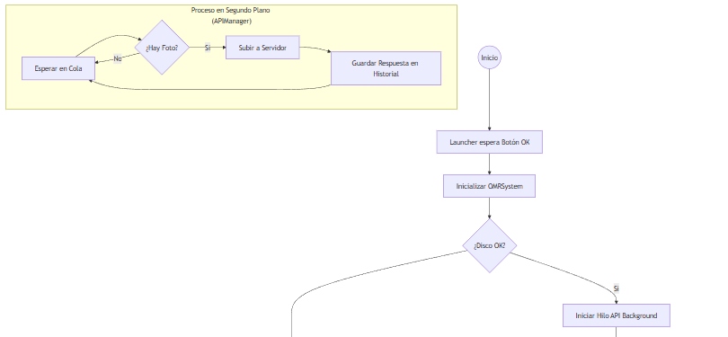

# Arquitectura del software

Este documento describe la versión final, que está en [`firmware/rpi-zero2w/`](../firmware/rpi-zero2w).

## Componentes



| Archivo | Responsabilidad |
|---|---|
| `launcher.py` | Bucle infinito: espera a que se presione OK y ejecuta `main.py` como subproceso. Cuando `main.py` termina (al elegir *Salir* o por un error), vuelve a esperar. |
| `main.py` | Clase `OMRSystem`: inicializa el hardware, comprueba la escritura en disco y ejecuta la máquina de estados. |
| `camera_manager.py` | Busca la cámara en `/dev/video*`, la abre con backend V4L2 en MJPEG (más rápido sobre USB 2.0), hace un *warm-up* de 5 frames y, en cada captura, descarta 4 frames del búfer para no fotografiar una imagen vieja (*anti-ghosting*). Si falla, se reconecta sola. |
| `api_manager.py` | Cola FIFO y un hilo *daemon* que sube cada imagen al servidor de IA y guarda en memoria las últimas 50 respuestas. |
| `display_manager.py` | Dibuja todas las pantallas con Pillow y las envía a la TFT ST7735 por SPI. |
| `input_manager.py` | Lee los 4 botones con *pull-up* interno (activos en bajo), con un *debounce* de 150 ms. |
| `config.py` | Pines, resolución, calidad JPEG, tiempo de validación, credenciales de la API (leídas del entorno) y logging rotativo (1 MB × 3). |

## Máquina de estados principal

`OMRSystem.run()` es un bucle que, en cada iteración:

1. Revisa el botón **RESET**. Si está presionado, hace un reinicio suave: apaga la cámara y vuelve a `MENU`.
2. Llama al manejador del estado actual (`loop_menu`, `loop_scan`, `loop_notas` o `loop_stats`).

Cada manejador dibuja su pantalla, lee **un** evento de botón y decide la transición. Ningún manejador bloquea por mucho tiempo; la única excepción es la espera a que se retire la hoja, y dentro de ella también se atienden RESET y OK.



## Sub-máquina de escaneo (`loop_scan`)



Mientras dura la verificación, se llama a `cap.grab()` en cada iteración para que el búfer de la cámara se mantenga fresco.

### Procesamiento de imagen

Lo hace `_procesar_estilo_escaneo_leve`, antes de guardar:

1. **Escala de grises** (`cv2.cvtColor`): reduce la memoria a la tercera parte.
2. **Recorte** de 100 px a cada lado, para quitar los bordes del soporte.
3. **CLAHE** (`clipLimit=2.0`, `tileGridSize=8×8`): ecualización de contraste local que realza las burbujas marcadas sin saturar la imagen.
4. Se guarda como JPEG con calidad 100 en `scans/scan_AAAAMMDD_HHMMSS_mmm_proc.jpg`.

Después de cada captura se llama a `gc.collect()`, para no agotar los 512 MB de RAM de la Pi Zero 2 W cuando la imagen es 1920×1080.

## Comunicación con el servidor de IA

El modelo de IA que corrige la ficha corre en un servidor externo. **No forma parte de este repositorio**. El dispositivo solo actúa como cliente.



### Petición

```http
POST {OMR_API_URL}
X-API-Key: {OMR_API_KEY}
Content-Type: multipart/form-data

file=<imagen JPEG>
```

El tiempo de espera es `OMR_API_TIMEOUT` (20 s por defecto).

### Respuesta esperada (HTTP 200)

```json
{
  "score": 14.5,
  "stats": { "correct": 29, "incorrect": 11, "total": 40 },
  "details": [ ... ],
  "process_time_seconds": 0.0599
}
```

### Registro que se guarda en el historial

| Campo | Origen |
|---|---|
| `status` | `OK`, `ERR` (HTTP ≠ 200) o `FAIL` (error de red o archivo inexistente) |
| `id` | Hora de la captura (`HHMMSS`), tomada del nombre del archivo |
| `nota` | `score` |
| `tiempo` | `process_time_seconds` |
| `correctas` / `incorrectas` / `total` | `stats.*` |

En la pantalla de detalle, la nota se pinta en verde si es ≥ 10.5 (aprobado en la escala vigesimal) y en rojo en caso contrario.

## Diagramas originales de la presentación

| Clases (preliminar, con motor) | Clases (final) | Flujo (final, detalle del hilo API) |
|---|---|---|
|  |  |  |

La presentación completa está en [`presentacion-bma20.pptx`](presentacion-bma20.pptx).

## Limitaciones conocidas

- **El historial vive solo en RAM.** Se pierde al reiniciar. Las subidas que fallan aparecen como `ERR` en el historial, y en el detalle se ve el motivo (por ejemplo `HTTP 500` o `Error Red`), pero no se reintentan.
- Desde la lista de **Notas** con historial, OK abre el detalle; para volver al menú se usa **RESET**.
