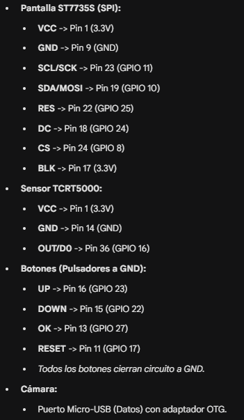
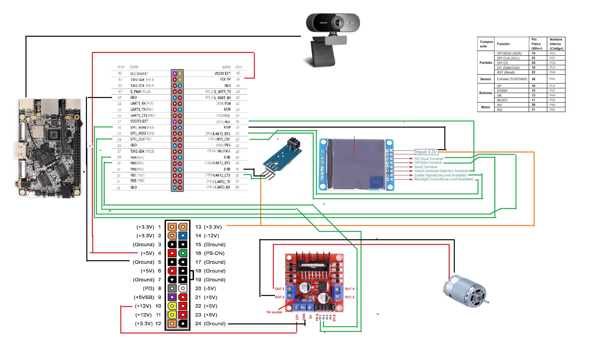

# Hardware y conexionado

## Lista de materiales

| Cantidad | Componente | Notas |
|---|---|---|
| 1 | Raspberry Pi Zero 2 W *(versión final)* o Orange Pi Win Plus *(prototipo)* | Raspberry Pi OS / Armbian |
| 1 | Webcam USB Full HD | En la Pi Zero 2 W se conecta con un adaptador micro-USB OTG |
| 1 | Pantalla TFT 1.44" ST7735, 128×128, SPI | El pin BLK (retroiluminación) va a 3.3 V |
| 1 | Módulo sensor IR TCRT5000 | Se usa la salida digital D0, que se activa en bajo cuando hay papel |
| 4 | Pulsadores | Conectados a GND; el código activa los *pull-up* internos |
| 1 | Motor DC + driver L298N | **Solo en las versiones `legacy`**, para expulsar la hoja |
| 1 | Fuente ATX | **Solo en el prototipo Orange Pi**: 5 V para la placa y 12 V para el motor |

## Raspberry Pi Zero 2 W (versión final)

| Componente | Señal | Pin físico | GPIO (BCM) | En `config.py` |
|---|---|---|---|---|
| Pantalla ST7735 | VCC | 1 | 3.3 V | — |
| | GND | 9 | GND | — |
| | SCL / SCK | 23 | GPIO 11 (SCLK) | `board.SPI()` |
| | SDA / MOSI | 19 | GPIO 10 (MOSI) | `board.SPI()` |
| | RES | 22 | GPIO 25 | `board.D25` |
| | DC | 18 | GPIO 24 | `board.D24` |
| | CS | 24 | GPIO 8 (CE0) | `board.CE0` |
| | BLK | 17 | 3.3 V | — |
| Sensor TCRT5000 | VCC | 1 | 3.3 V | — |
| | GND | 14 | GND | — |
| | D0 | 36 | GPIO 16 | `board.D16` |
| Botones (a GND) | UP | 16 | GPIO 23 | `board.D23` |
| | DOWN | 15 | GPIO 22 | `board.D22` |
| | OK | 13 | GPIO 27 | `board.D27` |
| | RESET | 11 | GPIO 17 | `board.D17` |
| Motor L298N *(solo `legacy/rpi-zero2w-motor`)* | IN1 | 29 | GPIO 5 | `board.D5` |
| | IN2 | 31 | GPIO 6 | `board.D6` |
| Cámara | USB | micro-USB de datos + OTG | — | auto-detección `/dev/video*` |

Hay que habilitar SPI con `sudo raspi-config`.

## Orange Pi Win Plus (prototipo)

| Componente | Función | Pin físico | Nombre interno |
|---|---|---|---|
| Pantalla | SPI MOSI (SDA) | 19 | `PD2` |
| | SPI CLK (SCL) | 23 | `PD1` |
| | SPI CS | 24 | `PD0` |
| | DC (Data/Cmd) | 18 | `PC4` |
| | RST (Reset) | 22 | `PH6` |
| Sensor | Entrada TCRT5000 | 36 | `PB3` |
| Botones | UP | 16 | `PL9` |
| | DOWN | 15 | `PH7` |
| | OK | 13 | `PH4` |
| | RESET | 11 | `PH5` |
| Motor (L298N) | IN1 | 29 | `PB4` |
| | IN2 | 31 | `PB5` |

En esta placa hay que habilitar el overlay de SPI1 (por ejemplo, con `armbian-config`). El L298N toma 12 V de la fuente ATX para alimentar el motor.
